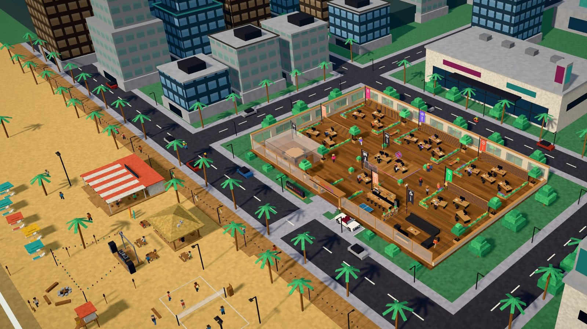
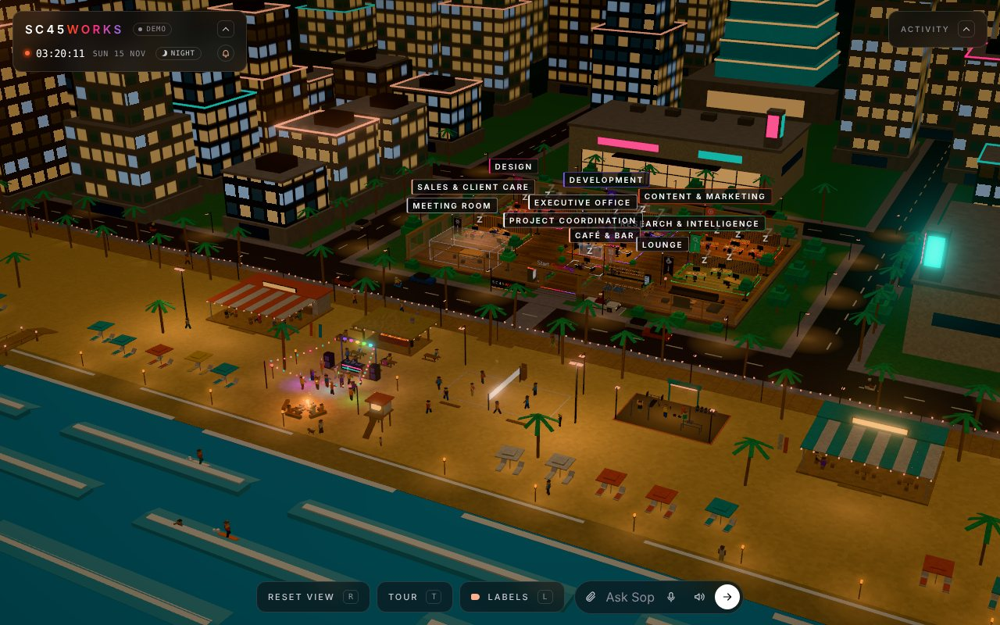
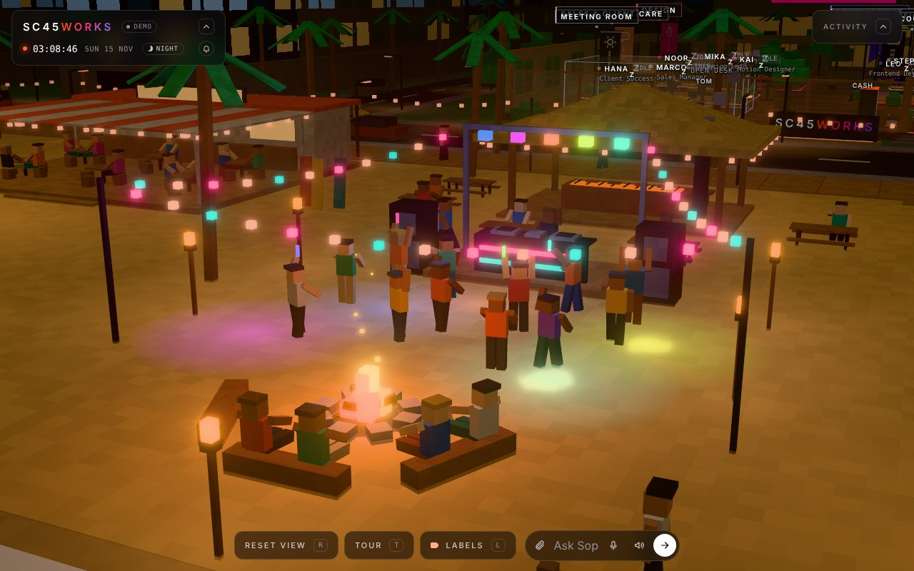
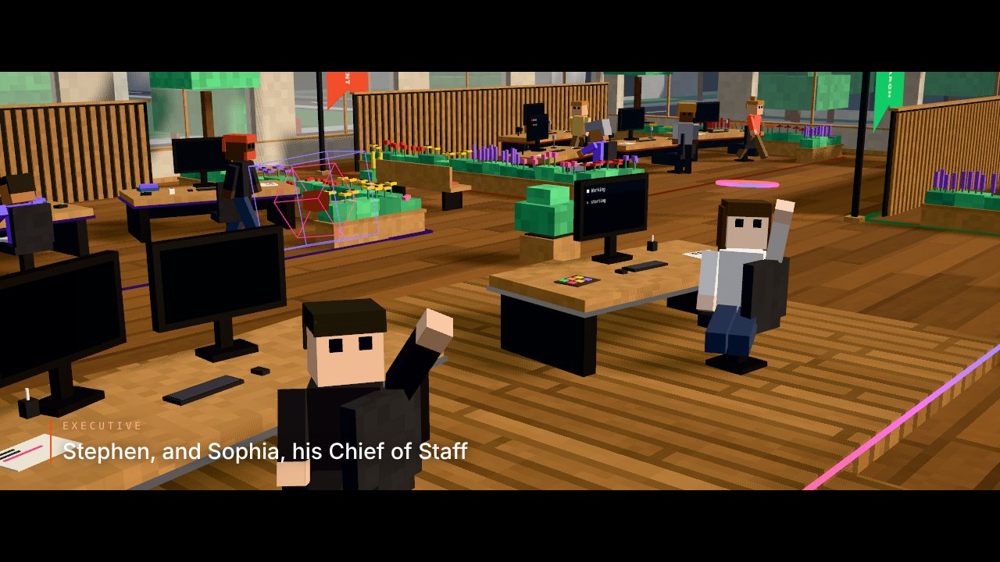

# SC45 AI Office

A 3D virtual office for a team of AI agents, built with Three.js and TypeScript. One founder,
a Chief of Staff, and fifteen agents across Design, Development, Content, Research and Sales:
you give the Chief of Staff a request, she plans it into a mission, and you watch the team
carry it out in an office by the sea.

By [SC45WORKS](https://sc45works.com): Solo Creator, Solo Creative.



| | |
| --- | --- |
|  |  |

## The demo

The hosted demo runs entirely in the browser. With no server behind it, the office plays a
scripted working day on a loop, so every part of the interface can be tried:

- **Drag** to orbit, **scroll** to zoom, **R** to reset the view.
- **Click an agent** to follow it: a panel shows its task, mission and files, and a sphere above
  it maps them as a graph. Click the hologram on the executive deck to open the whole company.
- **T** plays the tour: a two-minute film of the place, with music, from morning over the sea
  to a drone show over the city at night.
- **L** hides every name tag, to see the office as a place.
- The **time-of-day** button moves between the visitor's own clock, day, dusk and night. After
  dark the city lights up, Taipei 101 glows, and there is a party on the beach.
- Type a request to the Chief of Staff in the bar at the bottom. In the demo she plans it and
  the team acts it out; nothing real is written.

## What runs behind it, on your own machine

Run locally, the office is the front of a working system. Agents write events to a plain text
log, a small local server streams the log, and the office draws it:

```
agents ──emit──▶ data/events.jsonl ──▶ server (127.0.0.1:4545) ──SSE──▶ 3D office (browser)
```

Events flow one way. The office never calls an agent.

- **Real work.** With [Claude Code](https://claude.com/claude-code) installed and signed in,
  each task is done by a real worker, confined to a project folder, with a narrow set of tools.
- **Sign-offs.** Nothing starts, moves to its next stage or closes without the founder's
  approval, given on a card in the office and recorded in the log.
- **Honest reports.** Every agent ends its report with a verdict (done, partial or blocked),
  and a mission with unfinished work says so before it can be closed.
- **Review.** Finished work appears as a glowing folder on the founder's desk; open it to see
  what was made.
- **Voice.** The Chief of Staff can be spoken to and can answer aloud, using the browser's own
  speech features.

## Run it

Needs Node 22.12 or newer and [pnpm](https://pnpm.io).

```bash
pnpm install
pnpm dev          # the server and the office together: http://localhost:5173
```

```bash
pnpm dev:office   # the office alone, playing the demo
pnpm build        # the static site, in packages/office/dist
pnpm test         # the server and the shared rules
```

[docs/guide.md](docs/guide.md) is the full guide: every feature, every setting, and how to
change the people, the building and the plan.

## Deploy the demo

The demo is a static site. `vercel.json` is set up for [Vercel](https://vercel.com): import the
repository, keep the settings it finds, and deploy. Anywhere else, run `pnpm build` and serve
`packages/office/dist`.

A hosted copy never looks for a server, so it always plays the demo.

## How it is put together

```
packages/shared    the event format and the one reducer everything uses to read it
packages/bus       appends events to the log
packages/server    reads the log, streams it, plans missions, runs the workers
packages/office    the 3D office (Three.js, no framework)
company/           the Chief of Staff's instructions and a skill file for each agent
hero/office-hero   the office as a background for another web page, with a React component
docs/              the guide, the brief, the org chart, the architecture
```

A few things about the build that may interest another developer:

- Everything in the scene is made of boxes in code: there are no model or image files. Wood,
  sand and windows are small textures drawn to a canvas at start-up.
- The beach, the people on it, the surf and the gulls are one instanced mesh, so they cost one
  draw call. The static scenery is merged by material for the same reason.
- Sun shadows are drawn only when the sun moves; an idle view is drawn at half rate; phones get
  a lighter set of lights.
- The server accepts requests only from the local machine, and serves what agents build in a
  sandbox.



## Credits

Designed and built by Stephen Lee, SC45WORKS, Taipei.
The tour's title is set in Mr Dafoe (Google Fonts).

## Licence

Copyright © 2026 SC45WORKS. All rights reserved. This repository is a portfolio piece for
SC45WORKS's own use: you are welcome to look, but not to copy or reuse it. See [LICENSE](LICENSE).
